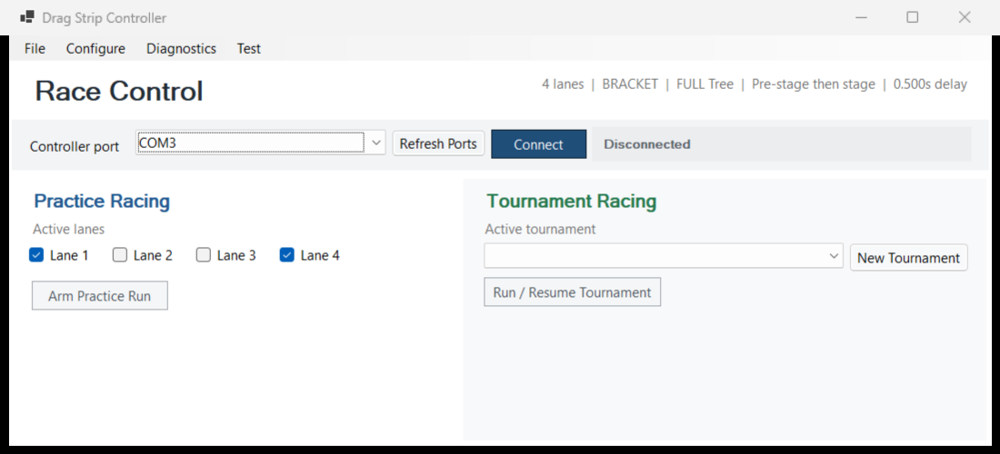

# Drag

Drag is an open-source slot-car drag timing and tournament-control system. An
Arduino Mega 2560 owns beam timing, Tree sequencing, and immediate race logic;
a .NET 10 Windows Forms application handles operator workflow, practice passes,
tournaments, reports, diagnostics, backups, and controller firmware updates.

> **Demo-ready beta (`v0.10.0-beta.2`):** Self-contained Windows x64 and ARM64
> packages are available in the [GitHub prerelease](https://github.com/tekrantz57/Drag/releases/tag/v0.10.0-beta.2).
> Extract the ZIP and run **Start-Demo.cmd** to try simulated races without
> a controller. See [Try It Without Hardware](docs/TRY_DEMO.md).
> Complete moving-car and four-lane hardware validation is still pending;
> this is not a production-qualified installation.

[](docs/images/dragwin-main.png)

## Capabilities

- Heads-up and bracket racing for two or four physical lanes.
- Full and Pro Tree timing with configurable staging behavior and staged delay.
- Current source adds optional on-screen Starter Button mode (DragMC 0.6.6 /
  protocol 9 required); this is not yet included in beta.2 downloads.
- Current source also builds an experimental Arduino Due ISR-capture port from
  the same race sketch. See [Due bench wiring and validation](docs/DUE_PORT.md);
  3.3 V interfaces and physical timing qualification are required.
- Practice passes, pass-result history, tournament setup, ordered lane choice,
  byes, advancement, and final standings.
- Current source adds an automatic, maximizable completed-pass scoreboard for
  practice and tournament heats, with side-by-side lane results, signed ET minus
  dial, and two-lane finish lead. Detailed history remains available; not in beta.2.
- Four required beam sensors per lane plus two optional interval timers.
- Controller-maintained sensor edge counts and raw blocked-pulse durations.
- Current source adds saved Sensor Test lane selection (protocol 11), with
  unused Due interrupts physically disabled and independent race capture scope.
- Cumulative interval, speed-trap, reaction, elapsed-time, speed, breakout,
  placement, foul, and DNF reporting.
- Local SQLite racer, car, tournament, pass, and settings storage.
- HTML reports with optional JSON and CSV exports.
- Verified manual restore, daily automatic backups, and pre-upgrade safety
  backups.
- Optional Windows SAPI, local Piper, or native Linux eSpeak NG announcements,
  disabled by default.
- In-app installation of bundled Mega firmware, plus current-source Due
  Programming-port updates with a separate BIN package and bossac uploader
  (physical Due updater validation pending; not in beta.2).

## Validation Status

Lane 1 has four LM393 sensors installed. Earlier cardboard interruptions
completed end-to-end passes; October 19 tests confirmed actual guide flags
during slow movement, but powered-car capture is not yet reliable. Source
firmware 0.6.7 removes the old speed-trap/finish qualification delay and adds
requested scan-timing measurements to investigate short and missing pulses.
This change is not yet physically validated or included in beta.2 downloads.
The 3/4-inch track deck remains a mounting constraint, and the venue owner does
not want routing. Preserve guide clearance and rigid optical alignment.

The two optional interval sensors per lane are implemented in firmware,
diagnostics, pass results, tournament history, and exports, but are not yet
installed at the track. Complete moving-car, four-lane, compatible-clone, and
production tournament validation remains pending.

See [Project Status](docs/PROJECT_STATUS.md) and [TODO](TODO.md) for the exact
completed and remaining work.

## Tested Platforms

| Environment | Verified result |
| --- | --- |
| Windows x64 | Primary development and physical-track environment |
| Wine 11 on Intel Linux | Self-contained x64 app, serial through `COM33`, automatic Windows avrdude download, and Mega firmware update |
| ARM64 Wine 11 on Rock 5B | Native Windows ARM64 DragWin through `COM1`, including Windows 32-bit avrdude download and successful Mega firmware update |

The ARM64 DragWin application ran without x64 CPU translation. The downloaded
uploader is the pinned Windows 32-bit `avrdude.exe`, which Wine also executed
successfully; DragWin does not invoke native Linux avrdude.

## Hardware Summary

- Controller: Arduino Mega 2560.
- Serial: USB serial at 115200 baud.
- Lanes: four, with two-lane mode using physical lanes 1 and 4.
- Required sensors: pre-stage, stage, speed trap, and finish in every lane.
- Optional sensors: Interval 1 and Interval 2 in each lane.
- Current LM393 polarity: active-HIGH, with 10k input pulldowns recommended.

The controller and sensor pin maps, wiring notes, optical-height limitation,
and Tree outputs are documented in [HARDWARE.md](HARDWARE.md).

## Repository Layout

```text
dragMC/                             Arduino Mega firmware
  dragMC.ino                        race and sensor controller
  FirmwareVersion.h                 controller firmware identity
  dist/                             matching DragMC firmware package

dragMCDueLightTest/                 Arduino Due Tree-output diagnostic
  dragMCDueLightTest.ino            light-test-only Due sketch

dragWin/                            .NET 10 Windows Forms application
  dragWin.sln                       solution
  dragWin.ProtocolTests/            lightweight integration test runner

docs/                               build, protocol, status, and operator notes
tools/Build-ControllerFirmware.ps1  reproducible Mega firmware packaging
```

The tracked `.dragfw` file is the controller image consumed and validated by a
DragWin source build. It is not a separately advertised application download.

## Build And Test

From the repository root on Windows:

```powershell
dotnet build dragWin\dragWin.sln -c Release
dotnet run --project dragWin\dragWin.ProtocolTests\dragWin.ProtocolTests.csproj -c Release
dotnet format dragWin\dragWin.sln --verify-no-changes --no-restore
arduino-cli compile --fqbn arduino:avr:mega:cpu=atmega2560 dragMC
```

The Windows application targets .NET 10. Visual Studio or the .NET SDK can
build it. See [Building From Source](docs/BUILDING.md) for firmware packaging,
local self-contained publishing, and clean-build expectations.

## Data And Privacy

DragWin writes its database, settings, serial logs, backups, and reports under
the operator's Windows profile and Documents folders. Those files are not part
of this repository. Racer names, car names, local paths, and serial activity can
appear in databases, reports, screenshots, and logs; remove private data before
sharing any diagnostic material.

## Documentation

- [Building from source](docs/BUILDING.md)
- [Try it without hardware](docs/TRY_DEMO.md)
- [Beta feedback and result-source labels](docs/BETA_FEEDBACK.md)
- [Beta package verification](docs/BETA_VERIFICATION.md)
- [Current project status](docs/PROJECT_STATUS.md)
- [Hardware and wiring](HARDWARE.md)
- [Four-lane commissioning checklist](docs/COMMISSIONING_CHECKLIST.md)
- [Tournament behavior](docs/TOURNAMENTS.md)
- [Controller firmware updates](docs/CONTROLLER_FIRMWARE_UPDATE.md)
- [Linux speech under Wine](docs/LINUX_SPEECH.md)
- [Piper speech](docs/PIPER_SPEECH.md)
- [Arduino Due light-tree diagnostic](dragMCDueLightTest/README.md)
- [Experimental Due race firmware and ISR sensor pin map](docs/DUE_PORT.md)
- [Serial protocol](docs/SERIAL_PROTOCOL.md)
- [Troubleshooting](docs/TROUBLESHOOTING.md)
- [Engineering backlog](TODO.md)
- [Third-party notices](THIRD_PARTY_NOTICES.md)

The canonical repository is maintainer-controlled and is currently published
as an experimental beta. Report reproducible beta bugs through
[GitHub Issues](https://github.com/tekrantz57/Drag/issues/new/choose); there is no
guaranteed support response. See [CONTRIBUTING.md](CONTRIBUTING.md).

## License

Drag is licensed under the [MIT License](LICENSE).
